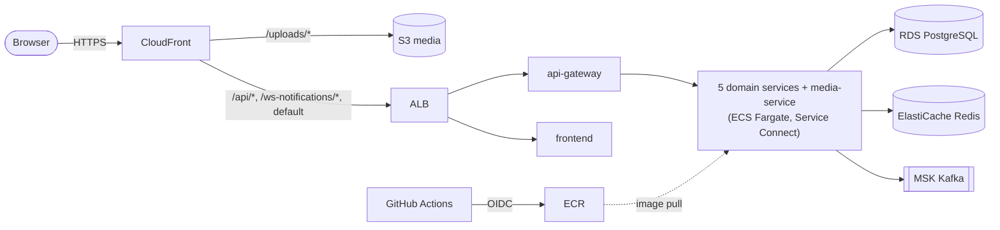

# BidNow on AWS: Deployment Guide and Runbook

All commands below are for a bash shell (Git Bash, WSL, macOS, Linux) and target region `ap-southeast-2` (Sydney). Replace `bidnow` with your own AWS CLI profile name if different.

## 1. Overview

BidNow runs as a three-tier stack defined entirely in Terraform:

- **Presentation:** CloudFront (the only public entry point, default `*.cloudfront.net` certificate) with two origins, the private S3 media bucket (`/uploads/*`) and an Application Load Balancer (everything else). The ALB only accepts traffic from CloudFront and returns 403 without the secret `X-Origin-Verify` header.
- **Application:** ECS on Fargate in private subnets, eight services (`frontend`, `api-gateway`, `identity-service`, `user-service`, `auction-service`, `bidding-service`, `wallet-service`, `media-service`) discovering each other through ECS Service Connect (`bidnow.local`). Eureka is not deployed.
- **Data:** RDS PostgreSQL 15 (one instance, one database per service), ElastiCache Redis 7, Amazon MSK (2 brokers, TLS) and the S3 media bucket, in isolated subnets.

Terraform is split into two stacks:

| Stack | Path | Lifecycle |
|-------|------|-----------|
| `bootstrap` | `infra/terraform/bootstrap` | Applied once, never destroyed: state bucket, 8 ECR repositories, GitHub OIDC provider and deploy role, AWS Budget |
| `envs/demo` | `infra/terraform/envs/demo` | Applied and destroyed on demand: network, ALB, CloudFront, ECS, RDS, Redis, MSK, S3, secrets |



The detailed diagram is in [diagrams/08-aws-deployment.md](diagrams/08-aws-deployment.md). The design rationale is in [superpowers/specs/2026-10-24-aws-deployment-design.md](superpowers/specs/2026-10-24-aws-deployment-design.md).

## 2. Cost note

While the `envs/demo` stack is running it costs about **$0.6 to $0.8 per hour** (Fargate tasks, one NAT gateway, the ALB, RDS, Redis and two MSK brokers; MSK is the largest line). That is roughly **$17 a day**, and **several hundred dollars a month if left running**. A three-hour demo costs a few dollars.

- An AWS Budget alert (created by `bootstrap`, default $30 per month) emails you when spend approaches the limit. It warns; it does not stop anything.
- **Destroy the stack as soon as you are done** (section 6). Only `bootstrap` (state bucket, ECR images, OIDC, budget) stays, which costs cents per month.
- `multi_az = true` adds a second NAT gateway, Multi-AZ RDS and doubles the task count, so it costs noticeably more.

## 3. Prerequisites

- An AWS account and an AWS CLI profile with administrator access (the stack creates IAM roles, VPC, MSK, CloudFront and more). Configure it once and select it:

  ```bash
  aws configure --profile bidnow
  export AWS_PROFILE=bidnow
  export AWS_REGION=ap-southeast-2
  aws sts get-caller-identity
  ```

- Terraform >= 1.10 (native S3 state locking). `envs/demo` additionally needs the `hashicorp/aws` provider >= 6.5; `terraform init` downloads it automatically.
- Docker (to build images if you do not use the GitHub workflow for the first push).
- GitHub CLI (`gh`) is optional; every `gh` command has a click-through equivalent in the repository settings.
- The repository must be on GitHub; the OIDC trust is scoped to the repository set in the `github_repository` variable of `bootstrap` (default `hiepnguyen06/bidnow-monorepo`). Override it with `-var github_repository=<owner>/<repo>` if you forked.

### Fargate vCPU quota

A new AWS account often has a low **Fargate On-Demand vCPU** quota. The stack runs 7 Java services at 0.5 vCPU plus the frontend at 0.25 vCPU per task:

| Mode | Tasks | Steady-state vCPU | Auto-scaling ceiling (max 2, or 4 with `multi_az`) |
|------|-------|-------------------|-----------------------------------------------------|
| `multi_az = false` (default) | 1 per service | 7 x 0.5 + 0.25 = **3.75** | 7.5 |
| `multi_az = true` | 2 per service | **7.5** | 15 |

Rolling deployments briefly run old and new tasks side by side, so keep headroom. Request **at least 8 vCPU** for the default mode and **16 vCPU** for `multi_az = true`.

```bash
# Current value (Fargate On-Demand vCPU resource count)
aws service-quotas get-service-quota --service-code fargate --quota-code L-3032A538 \
  --region ap-southeast-2 --query "Quota.Value"

# Request an increase (use 16 for multi_az = true)
aws service-quotas request-service-quota-increase --service-code fargate --quota-code L-3032A538 \
  --desired-value 8 --region ap-southeast-2
```

If the quota code is rejected, look it up: `aws service-quotas list-service-quotas --service-code fargate --region ap-southeast-2 --query "Quotas[].[QuotaCode,QuotaName,Value]" --output table`. Increases on new accounts can take from minutes to a couple of days, so request it first.

### MSK availability and quotas

Confirm Amazon MSK is usable in the region and that the account is not restricted (new accounts sometimes are):

```bash
aws kafka list-clusters-v2 --region ap-southeast-2
aws kafka list-kafka-versions --region ap-southeast-2
```

Both should succeed (an empty cluster list is fine). If you get `SubscriptionRequiredException` or an access error, open a support case or wait until the account is fully activated. See also the MSK quotas via `aws service-quotas list-service-quotas --service-code kafka --region ap-southeast-2`.

## 4. First-run order

Run everything from the repository root unless stated otherwise.

### 4.1 Apply `bootstrap`

`budget_email` is required; use an address you read.

```bash
cd infra/terraform/bootstrap
terraform init
terraform apply -var "budget_email=you@example.com"
```

Bootstrap uses a local backend (its state file stays in this directory; do not delete it). Note the outputs:

```bash
terraform output state_bucket
terraform output github_deploy_role_arn
terraform output ecr_repository_urls
```

AWS Budgets sends a subscription confirmation email; confirm it.

### 4.2 Set the GitHub repository variables

The Deploy workflow reads three repository **variables** (not secrets). From `infra/terraform/bootstrap`:

```bash
gh variable set AWS_DEPLOY_ROLE_ARN --body "$(terraform output -raw github_deploy_role_arn)"
gh variable set AWS_REGION --body "ap-southeast-2"
gh variable set LANDING_URL --body "https://<your-landing-site-url>"
```

`LANDING_URL` is baked into the frontend image (the landing site is hosted separately); it may be empty. Add `--repo <owner>/<repo>` if you are not inside a clone of it.

### 4.3 Get the images into ECR

`envs/demo` refuses to plan until every repository contains the tag in `image_tag` (default `latest`). There are two ways.

**Option A: the Deploy workflow (preferred).** The OIDC trust only allows runs from `refs/heads/main`, so this works only after the `feature/aws-deployment` branch is merged to `main`. Then:

```bash
gh workflow run "Deploy to AWS" --ref main
gh run watch
```

It builds all eight images, pushes them tagged with the commit SHA and `latest`, and skips the ECS rollout while the cluster does not exist (expected on the first run).

**Option B: manual fallback from your machine** (use this before the merge, or if the workflow is unavailable). From the repository root:

```bash
export AWS_PROFILE=bidnow AWS_REGION=ap-southeast-2
ACCOUNT_ID=$(aws sts get-caller-identity --query Account --output text)
REGISTRY="$ACCOUNT_ID.dkr.ecr.$AWS_REGION.amazonaws.com"
LANDING_URL="https://<your-landing-site-url>"   # same value as the GitHub variable; may be empty

aws ecr get-login-password --region "$AWS_REGION" | docker login --username AWS --password-stdin "$REGISTRY"

# Seven Java services: Dockerfile in services/<name>, build context is the services/ directory.
for svc in api-gateway identity-service user-service auction-service bidding-service wallet-service media-service; do
  docker build --platform linux/amd64 -f "services/$svc/Dockerfile" -t "$REGISTRY/$svc:latest" services
  docker push "$REGISTRY/$svc:latest"
done

# Frontend: build context apps/web.
docker build --platform linux/amd64 --build-arg NEXT_PUBLIC_LANDING_URL="$LANDING_URL" \
  -f apps/web/Dockerfile -t "$REGISTRY/frontend:latest" apps/web
docker push "$REGISTRY/frontend:latest"
```

Verify all eight repositories have the tag:

```bash
for r in frontend api-gateway identity-service user-service auction-service bidding-service wallet-service media-service; do
  echo -n "$r: "; aws ecr describe-images --repository-name "$r" --region ap-southeast-2 \
    --query "imageDetails[].imageTags[]" --output text
done
```

On Windows (Git Bash) `docker build` of the Java images can take several minutes each; Docker Desktop must be running.

### 4.4 Initialise `envs/demo`

The S3 backend is partially configured; supply the bucket at init time:

```bash
cd infra/terraform/envs/demo
terraform init \
  -backend-config="bucket=$(terraform -chdir=../../bootstrap output -raw state_bucket)" \
  -backend-config="key=envs/demo/terraform.tfstate" \
  -backend-config="region=ap-southeast-2" \
  -backend-config="profile=bidnow"
```

Drop the `profile` line if you use the default credential chain (`AWS_PROFILE` or environment credentials).

### 4.5 Configure and apply

```bash
cp terraform.tfvars.example terraform.tfvars   # git-ignored; never commit it
```

Edit `terraform.tfvars`:

- `aws_profile`: your profile name (or remove the line).
- `ecr_repository_urls`: paste the bootstrap output (`terraform -chdir=../../bootstrap output ecr_repository_urls`), replacing `<account>` with your account id.
- `mail`: the five SMTP values from your local `.env` (`MAIL_HOST`, `MAIL_PORT`, `MAIL_USERNAME`, `MAIL_PASSWORD`, `MAIL_FROM`). They go to Secrets Manager.
- `multi_az` and `image_tag` as needed.

```bash
terraform plan
terraform apply
```

Expect **25 to 35 minutes**, dominated by MSK cluster creation. The `terraform apply` is always run by hand; no pipeline applies or destroys infrastructure.

### 4.6 Open the app

```bash
terraform output -raw cloudfront_url
```

Open that URL in a browser. The hostname changes on every fresh apply. The first requests may return 502/503 for a minute or two while tasks pass health checks. Watch them with:

```bash
aws ecs describe-services --cluster bidnow-demo --region ap-southeast-2 \
  --services frontend api-gateway identity-service user-service auction-service bidding-service wallet-service media-service \
  --query "services[].[serviceName,runningCount,desiredCount]" --output table
```

## 5. Smoke checks

Run these from `infra/terraform/envs/demo` after the apply completes.

```bash
CF_URL=$(terraform output -raw cloudfront_url)
ALB_DNS=$(terraform output -raw alb_dns_name)
```

1. **The ALB is not directly reachable.** Expected `HTTP/1.1 403` (no `X-Origin-Verify` header; if the security group blocks you the request may instead time out, which is also a pass):

   ```bash
   curl -i --max-time 15 "http://$ALB_DNS/"
   ```

2. **CloudFront serves the app.** Expected `HTTP/2 200`:

   ```bash
   curl -i "$CF_URL/"
   ```

3. **Register and log in.** In the browser, register an account at `$CF_URL`. The OTP email must arrive (this also covers check 7). Log in afterwards. From the shell, the API route works through CloudFront too; replace the credentials:

   ```bash
   curl -s -X POST "$CF_URL/api/v1/auth/login" -H "Content-Type: application/json" \
     -d '{"email":"you@example.com","password":"<password>"}'
   ```

   A browser login that fails with 403 is a CORS problem (see troubleshooting).

4. **Upload an image through the presigned PUT.** In the app, create an auction and attach an image; it must succeed cross-origin from the CloudFront hostname. To test by hand, take the access token from the login response:

   ```bash
   TOKEN="<accessToken from the login response>"
   curl -s -H "Authorization: Bearer $TOKEN" \
     "$CF_URL/api/v1/media/presigned-url?fileName=test.png&contentType=image/png"
   ```

   Copy the presigned URL from the response and PUT a small PNG to it with the same content type, sending the CloudFront origin like a browser would:

   ```bash
   curl -i -X PUT -H "Content-Type: image/png" -H "Origin: $CF_URL" \
     --data-binary @test.png "<presigned-url>"
   ```

   Expected `200`. Then fetch the object through CloudFront at `$CF_URL/uploads/<key>` (the key is in the response) and expect `200`.

5. **Live bid update in two browsers.** Open the same live auction in two different browsers (or one normal and one private window) logged in as different users, place a bid in one, and see the price update in the other without a refresh.

6. **Idle WebSocket survives 90 seconds.** Open an auction page, leave it untouched for 90 seconds (longer than the 60 second CloudFront/ALB idle timeouts), then place a bid from the second browser. The first must still update. You can also watch the socket in the browser dev tools Network tab (WS filter): the connection must stay open with small heartbeat frames about every 10 seconds.

7. **Email arrives.** The registration OTP and the welcome email must land in the inbox of the SMTP account configured in `mail`. If not, check the `/ecs/media-service` log group.

## 6. Destroy and orphan check

```bash
cd infra/terraform/envs/demo
terraform destroy
```

Takes 10 to 20 minutes. Then confirm nothing billable from this stack is left. Every command below should print nothing (or an empty list):

```bash
export AWS_PROFILE=bidnow
R=ap-southeast-2

# NAT gateways (deleted and deleting ones are fine)
aws ec2 describe-nat-gateways --region $R --filter "Name=state,Values=pending,available,deleting" \
  --query "NatGateways[].[NatGatewayId,State]" --output text

# Elastic IPs
aws ec2 describe-addresses --region $R --query "Addresses[].[AllocationId,PublicIp]" --output text

# Network interfaces
aws ec2 describe-network-interfaces --region $R --query "NetworkInterfaces[].[NetworkInterfaceId,Description]" --output text

# CloudWatch log groups of the ECS services
aws logs describe-log-groups --region $R --log-group-name-prefix /ecs/ --query "logGroups[].logGroupName" --output text

# Secrets Manager (stack secrets are named bidnow-demo/...)
aws secretsmanager list-secrets --region $R --include-planned-deletion \
  --query "SecretList[?starts_with(Name, 'bidnow-demo')].[Name,DeletedDate]" --output text

# MSK, RDS, ElastiCache
aws kafka list-clusters-v2 --region $R --query "ClusterInfoList[].ClusterName" --output text
aws rds describe-db-instances --region $R --query "DBInstances[].DBInstanceIdentifier" --output text
aws elasticache describe-cache-clusters --region $R --query "CacheClusters[].CacheClusterId" --output text
aws elasticache describe-replication-groups --region $R --query "ReplicationGroups[].ReplicationGroupId" --output text

# Load balancers and CloudFront distributions
aws elbv2 describe-load-balancers --region $R --query "LoadBalancers[].LoadBalancerName" --output text
aws cloudfront list-distributions --query "DistributionList.Items[].[Id,DomainName]" --output text
```

Expected: nothing from this stack. (`describe-network-interfaces` in the default VPC may show unrelated interfaces; anything whose description mentions ELB, RDS, ElastiCache, Kafka or ECS from the destroyed VPC is an orphan. Delete the leftover resource named in the description, or contact AWS if it is stuck.) A CloudFront distribution may take several minutes to disappear from the list.

**`bootstrap` is never destroyed** as part of teardown: the state bucket, the ECR repositories with their images, the OIDC provider and deploy role, and the budget remain, so the next `apply` of `envs/demo` is quick and needs no new image push.

## 7. Troubleshooting

**Fargate or MSK quota errors during apply** (for example `You have requested more vCPU capacity than your current vCPU limit`, `ServiceQuotaExceeded`, or MSK `LimitExceeded`). Check and raise the quota as in section 3, then re-run `terraform apply`; it resumes where it stopped. ECS services stuck at 0 running tasks with the event `unable to place a task because ... vCPU` is the same cause.

**`Push images first: see docs/deployment-aws.md`** at plan time: one or more ECR repositories do not contain the tag in `image_tag`. The message lists the repositories that are missing it. Push the images (section 4.3) or set `image_tag` to a tag that exists.

**`RepositoryNotFoundException` (native AWS error) at plan time:** the bootstrap stack was not applied in this account and region, so the ECR repositories do not exist. Apply `bootstrap` first (section 4.1).

**The Deploy workflow finishes but nothing rolled out.** If the cluster `bidnow-demo` does not exist (stack destroyed or not yet applied), the roll step prints a notice and skips the rollout while still pushing images. That is expected.

**`ClusterNotFoundException` / `ClusterNotFound`** from `aws ecs ...` commands: the stack is not applied (or was destroyed), or you are in the wrong region or profile. Check `aws sts get-caller-identity` and `--region ap-southeast-2`.

**`Not authorized to perform sts:AssumeRoleWithWebIdentity` in the workflow.** The role trust only accepts `repo:<owner>/<repo>:ref:refs/heads/main`. The workflow must run from `main` (`gh workflow run "Deploy to AWS" --ref main`), the repository must match `github_repository` in `bootstrap`, and no job may declare `environment:` (that changes the OIDC subject). Runs from the feature branch or a pull request cannot assume the role; use the manual push (section 4.3, Option B) instead.

**A service keeps restarting and the `db-init` container fails.** Each database-backed task runs an idempotent `db-init` container that creates its database on RDS before the service starts. Read its logs:

```bash
aws logs describe-log-streams --log-group-name /ecs/identity-service --region ap-southeast-2 \
  --log-stream-name-prefix db-init --query "logStreams[].logStreamName" --output text
aws logs tail /ecs/identity-service --region ap-southeast-2 --log-stream-name-prefix db-init
```

Typical causes: RDS is not reachable yet (still creating; wait), or a wrong password secret. Replace the service name as needed. The application containers log to the same group under their own stream prefix.

**Login or API calls fail with 403 from the browser (CORS).** The gateway only accepts the browser `Origin` listed in `CORS_ALLOWED_ORIGINS`, which Terraform sets to the CloudFront URL. If it does not equal `terraform output -raw cloudfront_url` (for example the distribution was recreated and tasks run an older configuration), re-apply and force a new deployment:

```bash
aws ecs update-service --cluster bidnow-demo --service api-gateway --force-new-deployment --region ap-southeast-2
```

Also make sure you open the CloudFront URL, not the ALB address.

**The WebSocket drops after about 60 seconds.** CloudFront and the ALB close idle connections after 60 seconds. The web app and media-service send STOMP heartbeats every 10 seconds to prevent it. If it still drops, the running images are older than the heartbeat change: rebuild and push the images (section 4.3), then force a new deployment of `frontend` and `media-service`.

**Tasks cannot pull images (`CannotPullContainerError`).** The tag does not exist in ECR or the task has no route to ECR; check the NAT gateway exists and the tag is present (section 4.3 verify step).

**Destroy fails or hangs.** Re-run `terraform destroy`; ENIs from Fargate can take a few minutes to release before the subnets and security groups delete. Never delete the `bootstrap` state bucket by hand while the demo stack exists.
