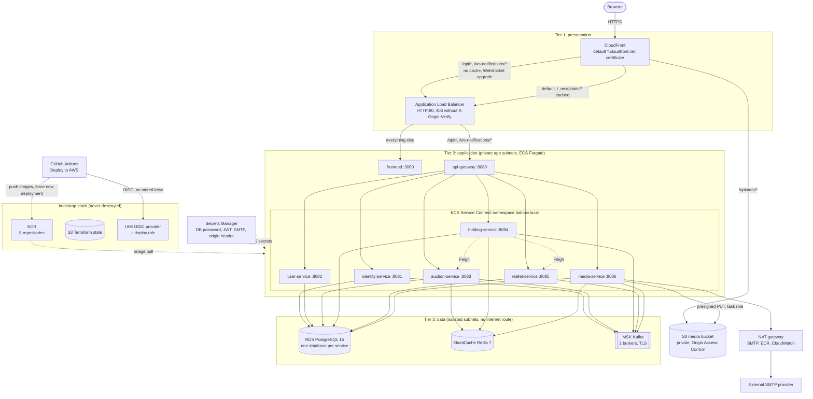

# AWS Deployment Architecture

Three-tier layout of the `envs/demo` Terraform stack in `ap-southeast-2`. CloudFront is the only public entry point; the ALB accepts traffic only from CloudFront (security group on the managed prefix list plus the secret `X-Origin-Verify` header). Fargate tasks, RDS, ElastiCache and MSK have no public addresses. The `bootstrap` stack (state bucket, ECR, GitHub OIDC role, budget) is applied once and never destroyed. See [deployment-aws.md](../deployment-aws.md) for the runbook.

